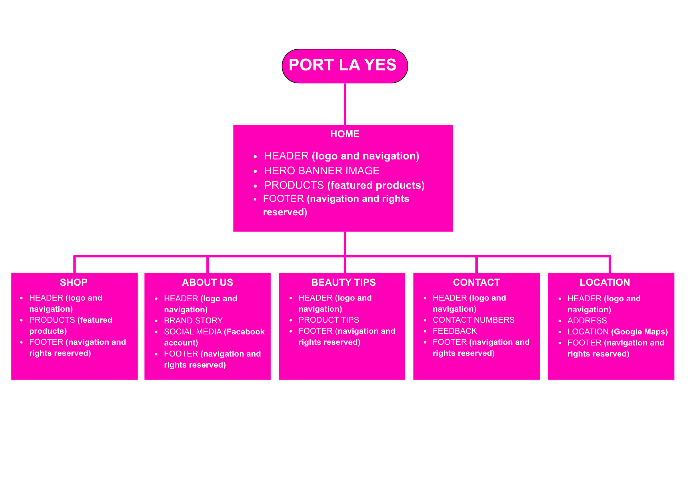
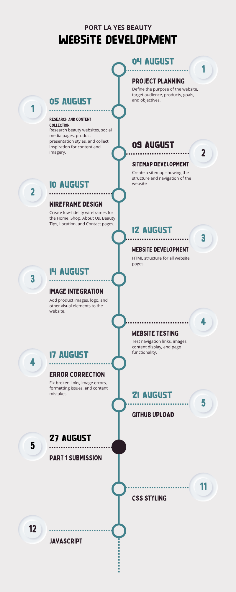
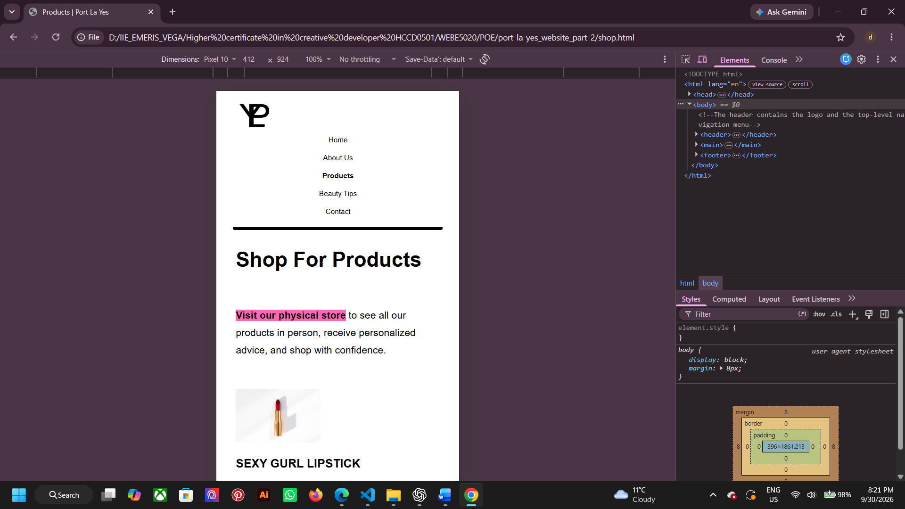
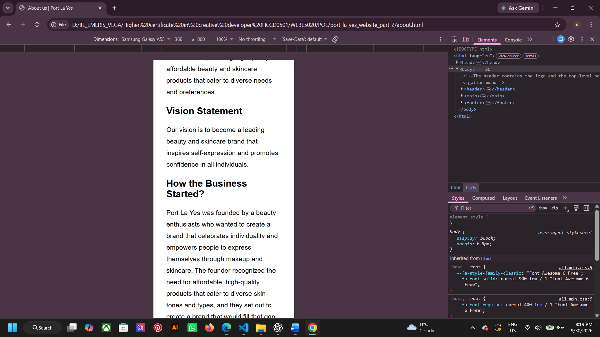
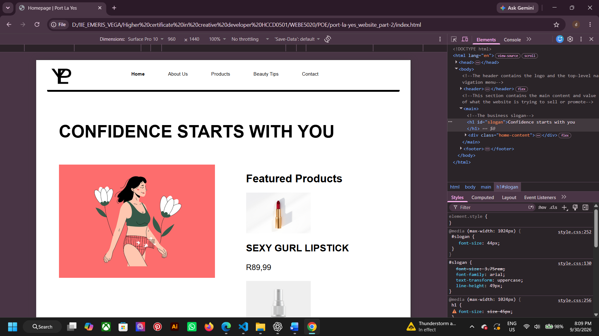
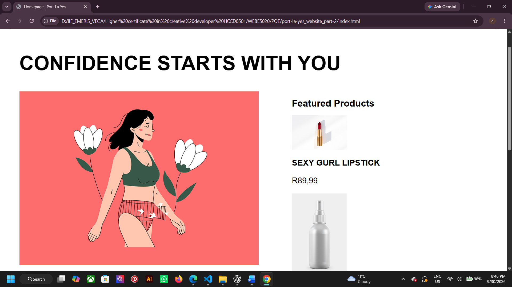

# **Port La Yes Website**
## Personal Information 
- **Name:** Dimpho Grace
- **Surname:** Mathibeli 
- **Student number:** ST10526119
- **Module: WEBDE5020** - Web Development (Indroduction)
- **Project:** Port La yes website development.

## Project overview
Repectfully, Port La Yes is a fictional small beauty business that needs a website to advertise their products to the locals. The brand focuses on empowering women both spirtually and physically. As the brand representative, we encourage confidence and self-expression.

# Project development
## Part 1 (Planning and HTML Structure)
The work includes:
- Defining the purpose of the Port La Yes website.
- Identifying the intended audience, including young adults, adults and beauty enthusiasts.
- Establishing the website's goals and objectives.
- Researching and gathering suitable content and visual assets.
- Planning the website structure and navigation. e.g sitemaps
- Creating the initial HTML pages and organising the project files into folders.

This is the structure/ skeleton of the website for a the later styling then functional working webpage.

## Part 2 (Designing the Visuals)
The work includes:
- The application of CSS as external styling sheets linked on diffrent webpages.
- The application of colour such as #fff3fb, black and white 
- Styling the header, logo, navigation menu, page content, product sections and footer.
- Developing a consistent visual layout across the website pages.
- Creating responsive layouts for mobile, tablet and desktop screen sizes.
- Resizing images, adjusting navigation links and the entire web spacing to create a well breathing space on diffrent devices

## Part 3 (Adding Functionally and SEO)
The implementation of Java script. Adding character, functionality, form validation and applying SEO practices.

The implematation of javascript includes:
- Adding an accordion so visitors can expand and collapse information.
- A lightbox display for products on the shop.html and index.html folders to inlarge images once clicked.
- Google maps intergration, to help guide those who nned help finding the business.
- Using CSS animations and transitions to improve interaction and visual feedback.
- Using JavaScript to manipulate page elements and update content. e.g copyright 
- Creating separate enquiry and contact forms for their different purposes.
- Adding client-side JavaScript validation and feedback for form input.
- Downloaded java coding snippets to make my work easier.

##  Website Goals
- Become innovative. 
- Build trust. 
- To attract new users.
- Build a forever-growing brand.
- Promote beauty products.

## Website Objectives
- Always require feedback.
- Provide clear contact information.
- Create a rich user experience. Easy navigation system.
- Maintain a professional website.
- Share beauty tips and address issues that oppose self-confidence.

## Target Audience
- Young adults 
- Adults
- Beauty enthuisast

## Products presented
| Product | Displayed price |
|----------|----------|
| Lipstick | (*R89.99*) |
| Mist spray | (*R79.99*) |
|Lip balm | (*R49.99*) |

## Site map

---

## Key Features and functionality
The website includes:

- **Navigation menu:** Provides links between the main website pages.
- **Featured products:** Highlights selected products on the homepage.
- **Product showcase:** Presents product images, names, descriptions and example prices.
- **Beauty tips:** Provides a section for beauty-related information and advice.
- **Accordion:** Allows visitors to expand and collapse additional information.
- **Lightbox gallery:** Opens selected images in a larger viewing display.
- **Google Maps:** Displays location information on the Contact page.
- **CSS animations and transitions:** Provide visual feedback and improve the browsing experience.
- **JavaScript DOM manipulation:** Allows page elements and displayed content to respond to user interaction.
- **Dynamic product content:** Uses JavaScript to display product information.
- **Product search/filtering:** Helps visitors find products within the product content.
- **Enquiry form:** Allows visitors to submit questions about the products or information presented on the website.
- **Contact form:** Allows visitors to prepare a general message for the organisation.
- **Form validation:** Uses HTML form attributes and JavaScript to check user input and display feedback.
- **Footer navigation and back-to-top link:** Helps visitors navigate the website and return to the top of a page.

## Technology used 
### Technologies and Tools Used

The project uses the following technologies and tools:

- **HTML5:** Provides the structure and content of the website pages.
- **CSS3:** Controls the website's presentation, layout, responsive behaviour, animations and transitions.
- **JavaScript:** Adds interactive behaviour, DOM manipulation, dynamic content and form validation.
- **jQuery:** Supports selected interactive website functionality.
- **Google Maps:** Displays map/location information.
- **Visual Studio Code:** Used to edit and organise the website files.
- **Adobe Illustrator:** Used during the visual design process.
- **Canva:** Used for design and project-planning materials where applicable.

## Design 
With a merged /combined P,L and Y minimalistic logo design the brand would love to equal that with a minimalistic website.

## Timeline and Milestones 

## Responsive Design
The website includes:
### Mobile beakpoints - (768px)

### Tablet breakpoint - (1024px)

### Desktop

# Changlog
### Part 1
- **Project planning:** Defined the purpose of the Port La Yes website, its goals, objectives and intended audience to guide the website's content and design.
- **Research and content gathering:** Collected information and suitable visual assets for the fictional beauty brand and its website pages.
- **Initial HTML development:** Created the initial HTML structure and website pages using Visual Studio Code.
- **Project organisation:** Organised the website files and supporting assets into folders to make the project easier to manage.
- **Sitemap and timeline:** Prepared planning visuals to show the website structure and project milestones.
- **Code comments:** Added comments to parts of the code to explain the purpose of selected sections.

### Part 2
- **On the 14 September 2026, feedback was recieved.**

| Feedback recieved | Changes made | Reason for change |
|----------|----------|----------|
|**More content is needed on the Home Page.**| Added featured products section and customer reviews. | To provide users with more information and improve engagement. |
|**More content is needed on the About Page.**| Expanded business background, mission statement and product infomation. | To explain what Port La Yes stands for. |
|**More content is needed on the Product (Shop) Page.**| Added detailed product description. | To provide clear product infomation. |
|**Add more content for the Contact Us page**| Made the decision to remove the enquiry or feedback form. Then considered adding a Google form for enquires and feedback at the (Beauty Tips page) | To improve communication, flow and allowing users to submit their enquiries online. |
|**Change "Shop" page name.**| Rename the page to Product. | Following the lecturer feedback. |
|**Merge the Location page with the Contact Us page.**| Merge the into a single page. | To reduce unnecessary pages. |
|**Navigation menu order is incorrect.**| Reorderd navigation menu to:Home-About-Product-Beauty-Contact. | To follow feedback requirements. |

- **External stylesheet:** Created an external CSS stylesheet and linked it to the HTML pages so that styling could be managed centrally.
- **Consistent styling:** Applied the brand's black, white and pink colour palette and developed a consistent layout across the website.
- **Responsive design:** Added responsive styling and media queries for mobile, tablet and desktop screen sizes.
- **Layout refinement:** Adjusted page sections, navigation, images and spacing to improve the appearance and usability of the website on different screen sizes.

## Part 3

The following functionality and improvements were implemented during Part 3:

- **Interactive accordion:** Added an accordion that allows visitors to expand and collapse information, making additional content easier to access.
- **Lightbox:** Implemented a Lightbox image gallery so visitors can select images and view them at a larger size.
- **Google Maps integration:** Added a Google Maps display to the Contact page to present location information.
- **Animations and transitions:** Used CSS animations and transitions to add visual feedback to interactive elements.
- **DOM manipulation:** Used JavaScript to interact with and update page elements in response to user actions.
- **Dynamic product content:** Implemented JavaScript functionality to display product content dynamically.
- **Product search and filtering:** Added functionality to help visitors search or filter the displayed product content.
- **Separate forms:** Maintained an enquiry form on "enquiry.html" and a general contact form on "contact.html", with each form serving a different purpose.
- **JavaScript form validation:** Added client-side validation to check user input and provide feedback when information is missing or invalid.
- **On-page SEO:** Added relevant keywords, page titles, meta descriptions, structured headings, descriptive image filenames and alt text, clean page filenames and internal links.
- **Responsive and mobile SEO:** Reviewed the website's responsive layout to support visitors using different screen sizes.
- **Robots file:** Created *robots.txt* in the website root directory to provide instructions for search engine crawlers and point to the sitemap.
- **XML sitemap:** Created *sitemap.xml* to list the main website pages and help search engines understand the website structure.

# Refrence list 
Adobe Illustrator. 2026. Adobe (version 30.3). [Desktop software]. [Accessed 12 August 2026, 2026]

Abouzeid, H. (2026). Menopause, women’s health, self love royalty-free stock illustration. [Online image] Available at: https://pixabay.com/illustrations/menopause-womens-health-self-love-10377296/ [Accessed 23 Aug. 2026].

Canva Pty Ltd. 2026. Canva (1.123.1). [Desktop software]. [Accessed 12 2026]

Chun, L. 2023. Welcome modal popup [Online code editor]. Available at: https://codepen.io/lmchun/pen/yLQMpBZ [Accessed 6 Nov. 2026]

How to create a CSS navigation bar in 6 minutes! 🧭. (2023). [Video] Directed by Bro Code. YouTube. Available at: https://www.youtube.com/watch?v=f3uCSh6LIY0 [Accessed 30 Sept. 2026].

Hoz, E. (2024). Lipstick, cosmetics, art royalty-free stock illustration. [Online image] Available at: https://pixabay.com/illustrations/lipstick-cosmetics-art-makeup-9009091/ [Accessed 23 Aug. 2026].

Learn CSS in 1 hour 🎨. (2021). [Video] Directed by Bro Code. YouTube. Available at: https://www.youtube.com/watch?v=wRNinF7YQqQ [Accessed 30 Sept. 2026].

Mediamodifier (2021). Spray, bottle, container royalty-free stock illustration. [Online image ] Available at: https://pixabay.com/illustrations/spray-bottle-container-cosmetics-5947445/ [Accessed 23 Aug. 2026].

Pop, F. 2019. Form Validation -#073 of #100Days100Projects [Online code editor]. Available at: https://codepen.io/FlorinPop17/pen/OJJKQeK [Accessed 6 Nov. 2026]

Psych2Go (2022). Body dysmorphic disorder.. what is it? [online] www.youtube.com. Available at: https://www.youtube.com/watch?v=Y4RriAr2AuU [Accessed 22 Aug. 2026].

Sami (2022). Bottle, mockup, perfume image. [Online image] Available at: https://pixabay.com/photos/bottle-mockup-perfume-product-7458645/ [Accessed 23 Aug. 2026].

SuperSimpleDev (2022). HTML & CSS full course - beginner to pro (2022). [online] www.youtube.com. Available at: https://www.youtube.com/watch?v=G3e-cpL7ofc [Accessed 30 Sept. 2026].

The Independent Institute of Education, 2026 Web development (Introduction)[WEDE5020] nt. [online via sharepoint] The Independent Institute of Education. Available at: https://advtechonline.sharepoint.com/:w:/r/sites/TertiaryStudents/_layouts/15/Doc.aspx?sourcedoc=%7BCCB67D67-54C6-4B72-871F-CF8C5B954C6A%7D&file=WEDE5020MM.docx&action=default&mobileredirect=true&share=cQpnfbbMxlRyS4cfz4xblUxqEgUCLNe9ab-zGeOYpowFzi1Buw [Accessed 6 Nov. 2026]

---

&copy; 2026 Port La Yes| All rights reserved.
